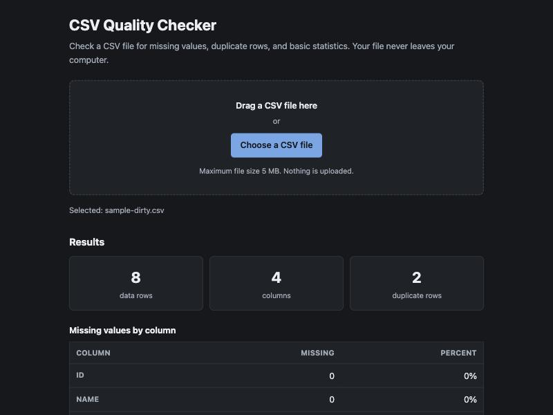

# CSV Quality Checker

> Students and data analysts waste time checking CSV datasets manually. The smallest version is a one-page tool that reads a CSV file locally and reports missing values, duplicate rows, and basic dataset statistics.

A privacy-first, browser-based CSV data quality checker. Your file never leaves your
computer: all parsing and analysis happen locally in your browser.



## The problem it solves

Before you can trust an unfamiliar CSV dataset, you need the basics: how many rows are
there really, which columns have gaps, and are any rows duplicated? Answering that today
means either writing throwaway pandas code or pasting your data into an online tool you
may not want to trust. The first assumes Python fluency; the second means handing a
dataset to a remote server, which is a non-starter for unpublished research or anything
containing personal information.

## What it does

- Select a CSV with the file picker, or drag and drop it onto the page.
- Reports **total data rows**, **total columns**, **missing cells per column** (count and
  percentage), and **duplicate data rows**.
- Explains malformed CSV with a specific error instead of showing misleading numbers.

### How the numbers are counted

- The header row is **not** counted as a data row.
- A cell is **missing** if it is empty or contains only whitespace.
- Percentages are calculated against the number of **data rows**.
- A **duplicate** is any repeated row after its first occurrence, compared on trimmed
  values, case-sensitively. Three identical rows count as two duplicates.

### Limitations

- CSV only. No Excel or XLSX.
- 5 MB file size limit: the file is parsed synchronously in memory, and larger files
  would freeze the page.
- A row with more fields than the header is rejected as malformed rather than guessed at.
  A row with fewer fields is accepted, and its absent trailing cells count as missing.
- No charts, no data cleaning, no export. See `SPEC.md` for what is deliberately out of
  scope.

## Running it locally

No build step and no dependencies:

```bash
git clone git@github.com:Jiahao419/csv-quality-checker.git
cd csv-quality-checker
python3 -m http.server 8000
```

Then open <http://localhost:8000>.

A local server is required rather than opening `index.html` directly from disk, because
browsers block ES modules on the `file://` origin.

## Using it

1. Open the page.
2. Drag a CSV onto the drop zone, or click **Choose a CSV file**.
3. Read the three summary metrics and the per-column missing-values table.

Try `examples/sample-dirty.csv`, a small synthetic file with known defects. It should
report 8 data rows, 4 columns, 2 duplicate rows, 4 missing emails (50%), and 1 missing
score (12.5%).

## Testing

Node 20 or newer, using Node's built-in test runner. No test dependencies:

```bash
node --test tests/
```

## Privacy

This page has no backend. Your file is read with the browser's File API and analyzed in
memory on your own machine. There is no `fetch` or `XMLHttpRequest` of file contents, no
analytics, and no external script or stylesheet, so the page works offline once loaded.
You can confirm this yourself in your browser's Network panel while analyzing a file.

## Project documents

- [`SPEC.md`](SPEC.md) — problem, architecture, parsing rules, acceptance criteria
- [`AGENTS.md`](AGENTS.md) — engineering constraints for contributors and AI agents

## Live site

Not yet deployed. The GitHub Pages URL will be added here once deployment is verified.

## Course

Boston University DS219 — Software Engineering Career Prep Workshop, Fall 2026.
Final portfolio project.
